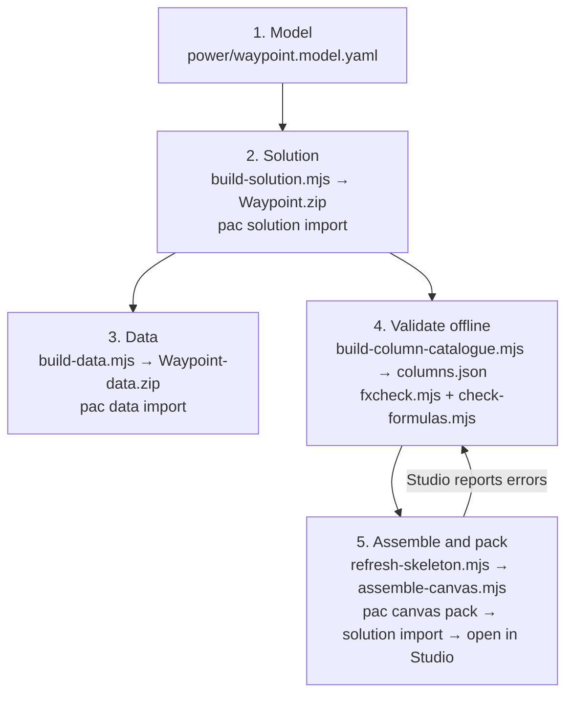

# Waypoint on Power Platform: playback

What we learned building Waypoint as a Dataverse solution and a canvas app from source, written so
the next app lands first time. The audience is a maker or a solution architect who was not there.

A few terms, once each. **Canvas app**: a Power App you lay out by hand, screen by screen, rather
than one generated from a table. **Power Fx**: the formula language a canvas app is written in.
**Dataverse**: the Power Platform's own database, where tables are parts of a solution. **Solution**:
the deployable unit that carries tables, apps, roles and flows between environments. **`pac`**: the
Power Platform CLI. **`.msapp`**: the packed binary of a canvas app. **YAML source**: the readable
text form of that app, which `pac canvas unpack` and `pac canvas pack` convert to and from.

---

## Summary

We set out to prove that Waypoint, a capacity planner that exists today as a React app and before
that as a workbook, could be rebuilt on Dataverse and a canvas app, and that the whole thing could be
generated from source files rather than clicked together in the browser.

Where we got to:

- A React prototype that is the specification: the design, the typed model, and a pure engine held to
  the workbook's own numbers by a parity test suite.
- A neutral model file, `power/waypoint.model.yaml`, from which a Dataverse solution is generated:
  27 tables, 209 columns, 43 relationships, imported as one unit.
- The seed data loaded into those tables from the export the React app writes itself: 319 rows in
  57 seconds, repeatable.
- A canvas app assembled from YAML sources, packed, imported inside the solution, and opened in
  Studio, with the Command screen and one work item screen bound to real Dataverse tables.
- An offline Power Fx checker, because Studio is the only full validator and each trip to it is
  expensive.

The approach was: prototype first, generate second, validate offline third, and only then open
Studio.

## How the pipeline works

Five steps, all of them scripted, all of them runnable from the repository root.

1. **The model is the authority.** One YAML file describes every table, column, choice, key and
   relationship.
2. **The solution is generated from it.** `scripts/build-solution.mjs` writes the unmanaged solution
   zip. Nothing under `power/solution` is edited by hand.
3. **The data comes from the app's own export.** The React app's "Export for Dataverse" writes one
   CSV per table; `scripts/build-data.mjs` turns those into the Configuration Migration package
   `pac data import` takes. The mapping from model to table lives in one place.
4. **The formulas are checked offline** against the columns the solution actually created.
   `build-column-catalogue.mjs` reads the solution, and `fxcheck.mjs` binds every formula with
   Microsoft's own Power Fx compiler against it.
5. **The app is assembled, packed and imported.** The skeleton is refreshed from the environment
   first, our YAML is written into it, `pac canvas pack` builds the `.msapp`, it replaces the one
   inside the exported solution, and the solution is imported. Opening the app in Studio is the only
   full validation, and what it reports goes back to step 4.

## How we ground the build in truth

Every step above answers to something outside the model, because a guess costs a round trip to
Studio and a wrong one costs more.

**Control identifiers come from the platform, never from memory.** A control type in YAML, such as
`Label@2.5.1`, is undocumented and unguessable, so a maker drops one of every control onto a scratch
screen, saves it, and we download and unpack it to read the exact `Control:` identifiers, their
versions and the property names Studio writes. Today that gave us the classic set first
(`Classic/Button@2.2.0`, `Label@2.5.1`, `Gallery@2.15.0` and the rest) and, once "Modern controls and
themes" was switched on in the same environment, the modern set behind it: `ModernButton@1.0.0`,
`ModernText@1.0.0`, `ModernTextInput@1.1.1`, `ModernDropdown@1.0.2`, `ModernCombobox@1.1.1`,
`ModernCheckbox@1.0.1`, `ModernToggle@1.0.0`, `ModernRadio@1.0.1`, `ModernDatePicker@1.0.1`,
`ModernTabList@1.0.1`, `ModernDataGrid@1.5.1`, `ModernCard@1.3.0`, `Header@0.0.44`, `Badge@0.0.24`,
`Table@1.0.278` and others. Guessing either name ahead of that screen would have cost a Studio round
each.

**Columns come from the imported solution, not the model.** The catalogue at
`power/canvas/columns.json` is generated from `customizations.xml`, the file the solution import
actually created, so a formula can only reference a column that exists in the environment. The day's
largest error family, app-computed columns that the model named but the solution builder never
created, is now caught offline, before anything is packed.

**Formulas are compiled before they leave the machine.** The Power Fx checker, Microsoft's own
compiler library typed with the catalogue, collections, named formulas and gallery scopes,
reproduces Studio's own binding messages. The YAML checker sits beside it and catches structure
errors Studio would reject on sight, the lesson behind the `//` versus `#` comment rule. An import
goes ahead only once both checkers report zero.

**The app in the environment is the skeleton every build starts from.** Before every assemble we
download the maker's latest save and build our screens into it, not into a blank app, so the
connections, the theme setting and any edit a maker made in Studio are preserved. The day's worst
regression, a push that overwrote the connected Dataverse tables with nothing, came from skipping
exactly this step.

**Truth is verified after the fact too.** Every import is confirmed by downloading the app again and
comparing it, file by file, with what was built and sent, and a data load is confirmed by counting
rows against the manifest afterwards, not assumed from an import that reported success.

Ask the platform, not the memory.
Nothing reaches the environment unverified.

## Where meaning drifts between agents, and how we stop it

Meaning drifts in four places in a build like this, and each one cost us a real fault.

**At the handoff into a brief.** The orchestrator compresses an instruction down to its shortest
correct form, and anything left implicit gets reinvented by whoever picks it up. "Convert `//`
comments to `#`" was correct for the YAML file as a whole, but it did not say "only at YAML level",
so it was applied inside formula blocks too and broke every Power Fx comment in them. The instruction
was right; the scope around it was assumed.

**Between workers who never met.** A later unit reads the current state of a file, not the reasoning
behind it, and "fixes" what an earlier unit did on purpose. The identifier-versus-string question in
`AddColumns` and `SortByColumns` column names, whether a name is a bare identifier or a quoted
string, was resolved correctly once and then flipped back twice by later units that saw a form they
didn't recognise and corrected it to the form they expected.

**Between a report and the truth.** A report is model output, and it is confident by construction,
which is not the same as being checked. The first solution import reported success with zero tables,
because the async import returns as soon as the job is queued and the failure happened after the
report was written. Separately, a reference note marked a set of layout properties "Studio-confirmed"
when what had actually happened was that they were found in our own build folder, a file we had
written ourselves, not one downloaded from the platform. A report inherits the confidence of the step
it summarises, not the confidence the reader assumes.

**Between the model and the world.** Formulas were written against the model file, the description of
what the tables should contain, rather than against the columns the solution import actually created.
Identifiers were guessed from memory or convention instead of read off a downloaded sample. Both are
the same failure: treating a description of the platform as the platform.

**Display labels are not property names.** Microsoft Learn describes controls by their Studio pane
labels ("Minimum width", "Gap", "Fill portions", "Flexible height gallery", Badge appearance "filled,
outline, ghost, inverted"); the YAML we write uses the tokens Studio itself emits (`LayoutMinWidth`,
`LayoutGap`, `FillPortions`, `Variant: VariableHeight`, `'BadgeCanvas.Appearance'.Filled`). Docs are
the source for what a property means; Studio-written YAML (`power/canvas` source samples or a
downloaded `.msapp`) is the only source for what it is called and which enum members exist. A doc
omitting a name is not evidence the name is wrong; a doc listing a value the catalogue lacks is a
prompt to check a Studio sample. Badge `Appearance` `Tint` is in our catalogue but absent from the
doc prose, and is confirmed only if Studio accepts it on the 20 September 2026 import.

What prevents each of these is not a smarter reviewer catching it after the fact, but removing the
conditions that produce it.

A single written contract goes to every unit verbatim: `power/RUNBOOK.md`, carrying its own rule that
a convention is never changed without updating the file it lives in. Nothing is passed on as a
paraphrase of an earlier conversation.

Ground truth is kept as artefacts, not as anyone's memory of a conversation: `power/canvas/columns.json`
built from the imported solution, `CONTROLS.md` captured from Studio, and the skeleton downloaded
fresh before every assemble. A unit reads these files; it does not ask what a previous unit believed.

Gates compile rather than get read. `yamlcheck` and `fxcheck` either pass or they don't, and nothing
is packed or imported until they say zero. This stands in for a reviewer reading a diff and judging it
plausible, which is exactly the step that let the Studio-confirmed note through.

Units stay small and carry one verb each, with an import kept as its own unit rather than folded into
a bigger one, so a failure names the step it came from rather than a batch of unrelated changes.

Verification runs against the world, not against the plan: downloading and byte-comparing the app
after every import, and counting rows against the manifest after every data load, rather than
trusting the report the tool prints on the way out.

Where the project is still exposed: `Formulas.pa.yaml` is one shared file edited by a sequence of
units, held safe today only by running them in order, and due to be split by domain so two units
cannot collide on the same lines. The modern control and layout container property names in the build
have not all been seen come back from Studio yet, so a wrong one would still pass every offline gate.
And a report can still overclaim on anything only Studio can show, because the checkers verify what
they can compile, not what they cannot see.

As a checklist: give a brief the explicit scope and the "do not touch" list, not just the instruction.
Hand over the runbook, not the chat that produced it. Keep every convention in a file, never in
someone's head. Capture every fact about the platform from the platform itself, never from a build
folder or a memory of an earlier session. End every unit with an artefact a machine can check. Have
the orchestrator verify state itself after any unit that ran out of turns before its own checks ran.
Never let one unit mix tool changes with content changes. Mark a fact "confirmed" only when Studio,
not our own output, is what showed it.

## The overnight build (20 September)

**What was built.** All ten screens now exist in the app: Command; Work item, with its stage actions
and five tabs; Work register; Team; Benefits, with the leave calendar drawn as a month grid; Financials;
Quarter close, running a real close sequence rather than a single button; Timeline, with all four of
its readings; Settings; and Import. The sprint grid is now the code component `wp_Waypoint.SprintGrid`,
carried inside the Waypoint solution as a root component, with the three-gallery version kept as a
fallback behind `varUseGridControl` so the app still renders if the control does not load. Full-window
display settings are patched into the packaged `.msapp`, since `pac canvas pack` cannot write them.
Dark mode is now persisted per user rather than per session. The bank holiday policy sits as an overlay
on the calendar rather than baked into the leave data.

**How the loop changed.** A screen is now two units, not one: structure and formulas first, then
gates to zero second, because a single-unit screen build had already run out of turns twice. An import
is its own unit too, roughly five minutes end to end and never folded into a content change, so a
failure names the step it came from. Nothing is packed or imported until both offline gates,
`yamlcheck` and `fxcheck`, report zero; that check now runs before every single import rather than
occasionally. The named-formula count is the clearest sign of the night's growth: 147 at the skeleton,
rising screen by screen to 594 now, with no drop anywhere in that line that wasn't a deliberate change.

**What was learned.** A column computed with `Text(x, "[$-en-US]...")` cannot be typed by the
validator's binder, and every `Filter`, `SortByColumns` or `LookUp` downstream of it then fails, so
formatting stays at the cell, never inside a table column. A table that has a table in one of its
columns cannot be filtered directly; the source must be filtered before it is flattened, the way the
Timeline grids handle `TlSnapPeople`. `SortByColumns` and `Search` want quoted strings, but a quoted
Dataverse display name is rejected outright, which cost a few wasted round trips before the pattern
was clear. Any plain scalar in the YAML containing a colon and a space has to become a block scalar or
be quoted, or the file fails to parse. `SaveData` and `LoadData` do nothing in a browser tab, including
Studio's own preview, so a preference such as the theme choice only survives a session in the player or
on mobile; a light-only Studio preview is not a bug. Code components need the canvas app component
feature switched on in the environment first, and travel with the solution only once added as a root
component by GUID, never by name. The Microsoft Learn corpus under `power/reference`, and its index,
is now the standing place to check a property or a function before guessing it.

**A check that cannot see the failure is not a check.** A success signal is only as good as what it
compares. Every gate must compare the whole artefact the platform consumes, the full msapp entry list,
not the part we author. When a defect has been fixed once by hand in Studio, the next question is
which file carries that fix and whether the pipeline copies it; if nobody can name the file, the fix
will be lost on the next import.

**Fix the class, not the instance.** A historical issue that returns has not been fixed, it has been
patched. The response is a gate that fails before import for the whole class, here an msappcheck
diffing download against build, and a single preflight command running every known-regression check,
recorded in the runbook, so the failure cannot recur silently. Craig's words: "it is not sustainable to
keep going back and fixing historical issues repeatedly."

**What is still unverified**, because only Studio can show it: the exact auto-layout property names
now in use, whether the modern controls behave as their documented properties suggest, whether the
code component's round trip through export and import survives untouched, and whether the `Patch`
sequences behind the quarter close and the work item stage actions actually commit in the order
written.

**Morning checklist for Craig.** Open the app in the player. Read the App checker's counts and treat
anything above zero as real. Compare the Command screen's numbers against the React prototype's own
figures for the same data. Try the Timeline screen with the grid control switched on, then off, and
check both render sensibly. Run one stage action on a test work item and confirm it lands correctly.
Try the theme toggle in the player, not in Studio, since Studio's preview will not show it working.

## The afternoon session (20 September)

Six things landed this afternoon. Size in the model and in Power Fx is points, not pixels, and every
text height had been computed two thirds short, showing scroll arrows on text that already fit; the
fix went into the line formulas and the composites built on them, not into a single screen. A brief
asserted that `GroupContainer` accepts `OnSelect` and `AccessibleLabel`; Studio rejected both with
PA2108, so the rule now stands that no brief may name a property that is not already Studio-confirmed
in `CONTROLS.md`, and preflight denies any property already known to be rejected for its control type.
Deleting a component from source had been leaving its file behind in the skeleton and in the
environment, so the assembler now prunes a removed file and records the removal, letting the package
check tell a deliberate prune from a real loss. "Import succeeded" was shown again not to be the same
as done; done is the maker opening edit mode with no error dialog, and every import is now followed by
that check before anyone claims it worked. Wide briefs continue to exhaust a worker's turn limit and
leave partial, unreported state, so units stay to one screen or one concern and carry a turn budget
with a required report. And running a content unit concurrently with an import invalidated the import's
poll, so an import lock now blocks assembly for the duration of an import.

## The evening (20 September): from screens to a product

**The screens looked right and did nothing.** Every create and every edit was a button with nothing
behind it. The person form was built first and became the pattern: one screen, one record, typed
fields, a `Patch` on save. Forms for work items, absences and assignments followed it rather than
inventing their own shape. The first two live saves landed in Dataverse first time.
**What we learned:** a screen that cannot write is a picture, not an app.

**Numbers proved by computation, not by reading.** The checker gained an offline Power Fx evaluator
that runs the app's own formulas against the seed data and compares the results with the workbook
fixture. Net 221.02 member weeks matched, and so did every squad figure. It also found one real
defect: team-held reservations were not being attributed to anyone. Parity is now a gate, and no
import passes without it.
**What we learned:** the only proof a number is right is running the formula that produces it.

**The finish walk closed a question we had parked.** "Can we commit this" had been written off as
impossible without user-defined functions, which the work environment will not have. It was a running
sum. Written as a named formula over the table, it now matches the React engine week for week.
**What we learned:** a blocked feature is sometimes only a badly framed one.

**Product decisions with Craig, taken in one pass.** One place per action, so no feature has two front
doors. No booking concept: assignments are made from the work item. Non-work time is typed absences,
for one person or many. Capacity holds stay as engine data rather than becoming a screen. Roles are
reference data with fixed grades. Timeline is read-only and gains an Availability reading. Anything
unlikely to be used is hidden rather than deleted, so nothing is lost and nothing is in the way.
**What we learned:** decide the product once, in words, before building the screen twice.

**The scroll-bar hunt.** Two rounds of text-height fixes changed nothing, because the arrows were
never on the text. They were container scrollbars. Every container now declares its own overflow
behaviour, and a check enforces it. The final cause was the modern Text control's own line-box
tolerance, not the text height table nor the containers alone. The fix was to replace all 641 text
controls with the classic label by script and deny the modern control in the property catalogue.
**What we learned:** diagnose from the pixels, not from the assumption.

**Studio remains the last word.** PA2108 taught the rule the hard way: a property asserted in a brief
is a guess until Studio has written it. The same held for code components, whose registration lives in
`Properties.json` and `Resources`, not where the core controls' registration lives. Done is not
"import succeeded"; done is the maker opening edit mode with no error dialog.
**What we learned:** the platform, not the brief, decides what is true.

**What is next.** Screenshots at three widths. The three remaining live saves, for absences and
assignments. RBAC through a Dataverse security role and an Entra group. Then the deliverable for the
work environment.
**What we learned:** ship the thin path end to end before widening it.

**For the deck.**

1. A screen that cannot write is a picture, not an app
2. One form became the pattern for all four
3. Proof by computation: 221.02 member weeks, matched
4. Parity is a gate, not a report
5. Decide the product in words before building it twice
6. Diagnose from the pixels, not the assumption
7. Studio, not the brief, decides what is true
8. Next: three widths, three saves, one security role

## Overnight (20 to 21 September): the product, not the screens

**Ruthless scope and the model under pressure.** Craig's bedtime brief: be ruthless, remove low value, make it exceptional. The model carries a decision on every number that currently hides inside a formula; that belongs on the surface where it can be changed. No time to lose on the screens; every minute goes to the engine.
**What we learned:** the model is the product, then the screens are the product on top of it.

**Command became Today.** Three real decisions moved from feeling like buttons to carrying business logic: calling a fit verdict on a commit, reading attention from the number that drives resource use, and closing one spike or opening the next. Sickness and unassigned stopped pretending to be decisions and became the data they are. Every action now lands in Dataverse.
**What we learned:** a decision is one where the operator chooses; the rest is reporting.

**Every number carries its judgement.** One threshold table drives every flag that marks a person as stretched or idle. One pattern reads tones through a colour input on the stat component rather than hardcoding them. A checker gap closed: the component catalogue now matches the instances a formula can actually bind to, catching undeclared inputs before they land.
**What we learned:** a magic number is a bug waiting to be found.

**The scroll bars ended.** Two nights of text-height tweaks had fixed nothing because the real cause was the modern Text control's own line-box tolerance. The fix: replace all 641 text controls with the classic label by script, and deny the modern control in the catalogue to keep it out of future work. The type scale stepped down to match.
**What we learned:** diagnose from the rendered pixels, never from the assumption.

**Platform, Lab, Team, Squad.** The platform model took shape: every table is team-scoped, scope runs from the highest to the smallest unit, and the selector lives in the header. The request table and the front-door form, both 37 questions wide, are designed and built but parked behind a feature flag until the four tables wire together in Studio.
**What we learned:** scope a question and build against an outline, not against a detail.

**The cheap agents.** Scribe and runner run on the smallest model now, fast and cost-free. Workers and reviewers refuse any brief wider than one screen or crossing more than one domain; they did so five times overnight, each refusal correct. The rule is in the brief, the answer is a single fact.
**What we learned:** a small unit with one job will not apologize for its limits.

**The evaluation log holds 25 builds.** Each claim and actual sit together, from Friday evening to this moment. The morning check will fill the last rows. What matters is that Craig can read the line and know whether the build did what it said.
**What we learned:** the evidence is better than anyone's memory of what landed.

**For the deck.**

1. The model is the product; the screens follow
2. A decision is one where the operator chooses
3. One threshold table, one pattern, one colour tone
4. The modern control is out; the classic works at scale
5. Platform, Lab, Team, Squad: scope the questions first
6. Small units with one job do not compromise
7. 25 builds, each with a claim and its actual

## What went well

**Generating the solution from a model file.** Once the import errors were visible rather than
swallowed, all 27 tables, their 209 columns and their 43 relationships landed in a single import.
Every table then answered a fetch for its primary column.

**Loading data from the app's own export.** 319 rows across 24 tables in 57 seconds, and repeatable:
the migration tool matches on the package's own record ids and reports "Switching Insert to Update"
on a second run rather than duplicating. Every row's id is a UUID v5 over its table and its alternate
key, so a lookup can name its target before the target is written, and two builds of the package are
byte-for-byte identical.

**The YAML round trip works end to end.** Download the app, unpack it to YAML, write our screens and
formulas into it, pack it, put it inside the solution, import, open. Comparing Studio's own saved
copy against what we wrote back turns up no rewritten formula, no renamed identifier and no changed
quoting. Studio adds only formatting: explicit `X: =0` and `Y: =0`, a blank placeholder for a
component property an instance never sets, and its own property order.

**The sample-screen trick.** Control type identifiers in YAML (`Label@2.5.1`, `Classic/Button@2.2.0`
and so on) are undocumented and unguessable. We made a screen in Studio holding one of every control,
downloaded it, and read the identifiers and their valid properties straight out of it. That sample is
kept at `power/canvas/sample3` and is the reference every control in the build was checked against.

**The offline validator.** `scripts/fxcheck.mjs` with `tools/fxcheck` reproduces Studio's messages
before an import. Its last run turned up five real faults, one of which was cascading into 282 of the
312 findings. A formula it reports is a formula Studio reports.

## What went badly, and the fix for each

| Symptom | Cause | Fix | Where it is documented |
| --- | --- | --- | --- |
| Solution reports success, environment has no tables | An async import returns as soon as the job is queued, while the server is still failing | `pac solution import --async false` | `power/solution/README.md` |
| "OptionSets import: FAILURE: Object reference not set to an instance of an object" | Global choice sets are rejected by this environment in every shape we tried | One local option set per choice column, named `<table>_<column>`, same labels and values. `--global-choices` restores the global block | `power/solution/README.md` |
| "The attributes must be defined for creating an EntityKey" | Alternate keys cannot be imported in the solution zip here | Keys are created by hand in the maker portal. `--with-keys` emits the block for another attempt | `power/solution/README.md` |
| "Input string was not in a correct format" on a lookup | `LookupTypes/@id` wants a GUID, not a logical name | Emit `<LookupTypes />` and let the `EntityRelationship` name the target | `power/solution/README.md` |
| "RelationshipDescription cannot be null" | Import refuses a relationship with no description | Write the column description, or a single space, into every one | `power/solution/README.md` |
| "Unable to open data file" before the package reaches the server | The data package part was named `schema.xml` | It must be `data_schema.xml` | `power/data/README.md` |
| "Create update field spec FAILED" on a whole record | A boolean written as `1` or `0` | Write `True` or `False`; the tool parses it as a .NET boolean | `power/data/README.md` |
| `pac canvas validate` answers "no longer supported" | The command was withdrawn at CLI 2.12.2 | Use the offline checkers; Studio is the only full validator | `power/canvas/README.md` |
| `pac canvas pack` succeeds on YAML that is not even well formed | Pack copies the files in verbatim and does not validate | Never treat a successful pack as a pass. Gate on `fxcheck` and `check-formulas` | `power/canvas/README.md` |
| PA2305: component instances not allowed under a Gallery | A canvas component may not sit inside a gallery template, directly or through a second gallery | The one instance in a gallery became a plain Label carrying the component's own Fill and Color formulas | `power/canvas/README.md` |
| PA1022: top-level object kind 'DataSource' not supported | Studio will not read a `DataSources` YAML file in the SourceCode layout, although the schema has the key | The file is not packed; it is kept as `DataSources.reference.yaml`, a record of which tables to connect | `power/canvas/README.md` |
| PA2108: unknown property `RadiusTopLeft` and friends | A classic Label has no corner radius | Properties removed; radius stays on Button, TextInput, Rectangle, Image and GroupContainer | `power/canvas/README.md` |
| PA2108: unknown property `OnSelect` and `AccessibleLabel` on a `GroupContainer` | A ManualLayout container takes neither an interactive nor a labelling property | Both removed from every container; preflight check 13, `properties`, reads a per-control-type deny list from `power/canvas/control-properties.json` | `power/RUNBOOK.md`, "Preflight" |
| PA2110: duplicate control name `wiRail` in `scrWorkItem` | Studio scopes a control name to its screen, and the screen carried the name twice | The second one renamed; preflight check 14, `names`, fails on any name repeated inside one screen file | `power/RUNBOOK.md`, "Preflight" |
| PA2231: custom property `OnSelectSquad` of kind Event with no `Default` | An Event custom property must declare the formula it runs, even an empty one | The property carries a `Default`; preflight check 15, `events`, fails on any Event property under `Src/Components/` without one | `power/RUNBOOK.md`, "Preflight" |
| A component cannot see the app's collections | `AccessAppScope` is off by default | Keep it off and pass data in as typed Table properties, which also makes the component testable | `power/build-guide.md` |
| A component's custom property is an unknown name to the checker | Custom properties are declared only in the component YAML | `fxcheck.mjs` reads the `CustomProperties` block and types the component as a record | `power/canvas/README.md` |
| "'ItemSized' is an unknown or unsupported function", 98 times | User-defined functions are a preview feature and the work environment will not have it on | Every function became either a named formula producing a table with the computed column already on it, or the same expression written inline. Rules no screen binds to yet are parked | `power/canvas/README.md` |
| "Name isn't valid. 'Value' isn't recognized" on a choice column | A Dataverse choice is an enum, not a record | Read it with `Text(...)`, compare and patch with `'Kind (Work items)'.Feature`. Lookups are the opposite and do carry `.Value` | `power/canvas/README.md` |
| "Expected identifier name" on `AddColumns` | This app has the modern behaviour: a column name is a bare identifier, and `"Col"` is a text value in an argument that wants a name | Every column name in `AddColumns` and `GroupBy` is an identifier; a name with a space takes single quotes | `power/canvas/README.md` |
| "Use of a reserved word that is currently not supported" | `Children` was used as a column name. `Child`, `Children` and `Siblings` are reserved even though nothing uses them | Renamed to `ComponentCount`. Also `Not X` became `!X`: `Not` is a function, not a prefix operator | `power/canvas/README.md` |
| "Incorrect format specifier for 'Text'" | `0.##` and other `#` after the decimal point | Formats are en-US with no trailing `#`: `"[$-en-US]#,##0.0"`, `"[$-en-US]#,##0"`, with `£` as literal text outside the format | `power/canvas/README.md` |
| `Navigate` refused in `App.OnStart` | OnStart cannot navigate | Set `App.StartScreen` instead, to a screen that exists. Ours pointed at `scrLoading`, which no file defined | `power/canvas/README.md` |
| PA1001: duplicate property 'StartScreen' | Studio writes its own `StartScreen` first, and the merge added ours below it | The assemble script drops `StartScreen`, `OnStart` and `Formulas` from the skeleton's properties before writing ours | `power/canvas/README.md` |
| 467 errors, 378 of them in one block, from one bad column | The model marks some columns `computedIn: app` or `computedIn: dataverse`, and the solution builder never creates those, so formulas referenced columns that did not exist. A named formula that errors has no columns, so every reader of it errors too | The catalogue is built from the solution, not the model, so a missing column is found offline. `ComponentCount` is now computed as an `AddColumns` step | `power/canvas/README.md` |
| A maker's Studio "Add data" connections disappeared after a push | Those connections live in the `.msapp`, and we packed from a stale downloaded skeleton | `refresh-skeleton.mjs` before every assemble, and `assemble-canvas.mjs` refuses to pack when no data source name starts with `wp_`, unless `--allow-empty-datasources` is passed | `power/canvas/README.md` |
| PA2401: Unknown Code Component `wp_Waypoint.SprintGrid` after a layout calibration import that had reported success | The pipeline copies only Src YAML from the Studio-written download into the build; the code component registration Studio wrote lives in msapp parts outside Src, so pack dropped it. The post-import check compared Src only, so it reported success while the app was broken. An earlier "grid control back" claim rested on the same check; the user's screenshot showing no grid was the true result | Compare the full msapp entry list after every import, not just Src | `power/canvas/README.md` |

| Every text control rendered two thirds too short, with scroll arrows on text that fit | `Size` in the model and in Power Fx is points, not pixels | Fixed at the source: the line formulas and the composites derived from them now compute in points | `power/canvas/README.md` |
| A deleted component's file stayed in the skeleton and in the environment after its unit removed it from source | The assembler only ever added files; it never checked for one that had been taken away | The assembler now prunes a removed component's file and records the removal, so the package check can tell a deliberate prune from a real loss | `power/canvas/README.md` |
| The morning's reading that Studio had never registered `wp_Waypoint.SprintGrid`, because no download carried it in `References/Templates.json` | That list holds core controls only. Studio registers a custom control elsewhere: a `CustomControl` record at `Properties.json` > `LocalDatabaseReferences` > `default.cds` > `components`, plus the compiled bundle at `Resources/Controls/Waypoint.SprintGrid.bundle.js`. Both were in the download all along | The gate and the patch now judge registration on either form, and carry the record, the bundle and its css when a pack loses them | `power/RUNBOOK.md` |
| A content unit ran concurrently with an import and its poll came back invalid | Two units touched the same build state at once | An import lock now blocks assembly while an import is in flight | `power/RUNBOOK.md` |

Two rows in that table were the expensive ones: the computed-column fault, "467 errors, 378 of them
in one block", and the maker's Studio "Add data" connections disappearing after a push. The first
produced hundreds of messages from a single root; the second quietly undid a person's work in
Studio.

## Gotchas

**The CLI.**

| Thing | What to do |
| --- | --- |
| `pac` is not on PATH in Git Bash | Set PAC_CMD to its full path; the scripts read it. Call it as `pac` otherwise |
| Choosing the environment | `pac env select --environment <url>`, then confirm with `pac org who` before any import |
| `pac org fetch` rejects `top` | Use `count`: `<fetch count='1'>...</fetch>`. "No results returned" is the pass for an empty table |
| `pac canvas download` | Takes `--file-name`, not a path argument |
| Imports report "The underlying connection was closed" | Not a result. Wait and rerun the same command |
| Imports report "Cannot start another [Import] because there is a previous [Import] running" | Also not a result. Wait a minute and rerun. The import often landed while these were printing |
| The only honest check | Download the app again, unpack it, diff the `Src` against the build, and read `References/DataSources.json` out of the `.msapp` |

**The environment.** The build ran on a personal developer tenant with no billing plan and no
pay-as-you-go attached. The Developer Plan covered everything we did. The rule we worked to was
**build, never consume**: no metered capacity was spent. Copilot Studio and AI Builder were kept out
of the build for that reason, and the Jira pull that would use Copilot Studio stays a design, not a
thing we ran.

**Other things worth knowing.** Dates in the data package are written at noon UTC, so a date-only
column lands on the day the seed names whichever way the environment's time zone leans. The React
engine works in UTC, and Power Fx dates are local by default; the two timeline checksums are the
cheapest way to prove the date arithmetic before anything else is trusted. A `#` inside an SVG colour
breaks a canvas `Image` silently.

## The checklist for next time

1. **Decide classic against modern controls before you write a line of YAML**, and capture the
   identifiers by making one sample screen in Studio with one of every control on it, downloading it
   and reading them off. Do not guess an identifier or a property name.
2. **Decide about preview features deliberately.** Find out whether the target environment has them
   on. If it does not, do not use user-defined functions: write named formulas that carry the
   computed column on the table instead.
3. **Generate the tables from a model file.** Keep computed columns out of it, or mark them so
   clearly that nothing downstream reads one. Build the column catalogue from the solution, never
   from the model.
4. **Import synchronously.** `--async false`, every time.
5. **Load data once and verify the counts**, table by table, against the manifest, then verify the
   figures against the parity fixture.
6. **Add data sources in Studio once**, then refresh the skeleton immediately. Never pack from a
   skeleton older than the last Studio edit.
7. **Run `fxcheck` and `check-formulas` to zero** before any import. Zero errors and zero skipped
   formulas is the only acceptable result.
8. **Small units.** Six tables and two screens is a proving slice; 27 tables and ten screens is not.
9. **One thing per import.** Solution, then data, then app. A failure then names itself.
10. **Keep Studio closed during an import**, and have makers say when they have edited in Studio, so
    the sources are pulled before the next push.
11. **Park what no screen reads.** Studio validates the whole App entity, so an unread formula with an
    error in it is one more message between the maker and the one that matters.
12. **When searching a GitHub repository for something not surfacing, clone it shallowly and grep.**
    Search engines and single-file fetches miss files deep in the tree. Time-box naming research,
    because a token that Studio has accepted and rendered in the live app is already confirmed and no
    document outranks that.
13. **Before declaring an import successful, run the post-import full-package check**, and where the
    change touches Studio-registered things, code components, connections, datasources, have the
    maker open the app in Studio once before any further work builds on it.

## Monday morning (21 September)

The morning check started at 08:53 with an accessibility sweep landing 17 errors across four control classes. Transparent hit buttons needed inset focus rings and tab stops; link labels needed tab stops; icon-only buttons and images needed accessible labels. Check 24 enforced all four rules. Studio's checker had reported 660 focus gaps, 727 missing tab stops and 35 unlabelled controls; the sweep moved those counts down to the smaller set that remained.

Studio rejected `PressedBorderThickness` on `Classic/Button` with 16 PA2108 entries. The property was never written. It now lives as a ruled rejection in the deny list instead of a discovery. Twelve containers in the front-door screen carried `Children` inside their `Properties` block, which the YAML schema rejects. The assembler gained check 25, running a strict parser on every source file, catching that structural breakage before anything is packed.

At 09:28 the formula panel opened with 32 errors. The custom column `wp_status` had collided with the system Status column. Power Fx saw two Status names and bound neither. The display name was renamed to Request status. Check 26 now reads `power/canvas/columns.json` and fails if any table has two columns sharing a display name, catching this class before import.

The scope filter's delegation learned the With pattern, a delegable predicate over a filtered lookup, replacing a filter chain from an unfiltered collection. Delegation warnings fell from 21 to zero. The form tried a ModernButton Transparent as a hit target over the card; the classic button pattern held.

A tab gate caught a small defect: when one tab was selected and another row was flagged, clicking the flag moved to the wrong tab. The reviewer found an inversion in Realised, a row condition checking the wrong sign.

At 11:55 the runner picked up a stale lock file and waited, treating the import as in flight. The lock was cleared by hand.

Four builds landed today. Twenty-six checks now run before every import.

## Monday evening (21 September)

The codebase review commenced with twelve Opus reviewers on the two Waypoint components, one file or one concern each, across the eighteen section files and the build pipeline. The report landed at `power/AUDIT.md` with ninety findings, ranked and ordered for phased remediation.

Font sizes in the design system were labelled as pixels but applied as points. The scope leak from literals into role names was role drift, not a mistake in the YAML. A sweep of every font variable fixed it. Check 29 holds the rule.

Five data tables had been positioned 32 pixels above their header cards. The same field in `tables.json` controlled all five. One fix held all five.

Static analysis found approximately three thousand lines of dead code and one hundred and eleven dead formulas. They were removed with check 28 backing them. The pipeline then had no risk of reviving them.

The front door form's cached table metadata had come into conflict with the solver's own requests. Check 30 runs after every import to reconcile them through the pipeline, so that form reads the world as the app understands it, not as an earlier screen cached it.

Parity still held at seventeen: the Command screen's net member weeks and the per-squad figures all matched the expected values. Numbers that had disagreed across screens—read-only displays, computed columns, named formulas reading the same source—were given a single definition each at their source.

At 19:54, the build would not open. `patch-msapp` had round-tripped the `.msapp` package JSON through `JSON.parse` and rounded two 64-bit integer limits. The after-check compared names but not numeric values, so it passed the broken package. The fix protected big integers in the round-trip and compares every numeric literal with the download now.

A named formula bound to a control was caught in the pre-import check before it landed in the environment and broke assignment. It is now held as a rule on the control set rather than a formula.

The 20:18 build opened in the player with no errors.

Thirty-one checks now run before every import. Check 32 is in progress. Six builds landed today.

The 19:54 build would not open. The root was at 10:54: `patch-msapp` had rounded big integers in the package JSON. Every rebuild from 19:54 to 21:13 drew its base from the poisoned download, so the after-check passed broken packages against the broken reference. The 21:34 bisect used the 10:54 skeleton with only Src replaced, and opened: the cause was outside Src. The rule: the package base is a golden skeleton that advances only when Studio has opened a build; a download from the environment is never a base, and the after-check compares against the golden.

## Overnight into Tuesday (22 September)

Craig went to bed with a build that opened. The overnight run took the audit's Phase 1 visual classes one screen at a time, completing by 03:30 with build ten.

Contrast was measured in both themes by a new check and fixed at the token level. Thirty-nine faults reduced to zero through four token value changes and one new token. Check 27 holds the rule. Badges were sized to fit their labels: four as component pills, eleven across galleries by script. Dead vertical space closed on Team, Quarter close, Command and Financials, those four cards becoming a two-by-two grid that fits 1080 vertically. Benefits rows sat on one pitch. Timeline columns followed the sprint length, the legend a gallery for every kind. Settings lists compiled from tables.json. Work rows wrapped and became clickable. Import steps became a tab list.

Two reviewer FAILs caught real faults. Compact clipping on Financials rows; head gutters disagreeing with row gutters on Timeline. Both became check clauses. One worker refused a bundled brief and one ignored an instruction found in tool output; both correct. Thirty-five checks now run before every import.

**For the morning.** Open build ten. Walk each screen in both themes. Expand one example of each accessibility class.

The expand button in the rail footer was present in source across sixteen builds and never rendered because the container that held it was set to hide without zeroing the child's dimensions. The lesson is that "present in source" is not evidence of rendering. The player is the only check.

## Tuesday: the journey

The visual standard held for a day. Craig then asked for the flow of work to be designed as a journey with actors, inputs, outputs and transitions. A first draft was rewritten by Craig into rev2, introducing five stages, a Stop exit, spikes on a shorter track, a claim required at commit, capacity on the commit form, components inheriting assessment, and the stepper built third. Five decisions answered its open questions and the model was adopted.

The spine landed in build twenty-one: a Validated and Stopped phase in the model, source and dates, one people mechanism, a kind-aware stepper. Build twenty-two carried intake in both channels, the front door as a screening queue only, and assessment with a commit gate naming what is missing. Return and Stop came next. The engine now drops a stopped item's capacity from its stop date. Two checks tightened: absent columns and confirmed properties.

**What is still to come.** Command's commit on shared gate; delivery and Mark released; awaiting-validation queue; commit form capacity; Stop and Reopen everywhere; stopped-on date model change.

## What offline parity proves

`scripts/parity.mjs` runs the canvas app's own named formulas, offline, against the same seed data
and the same pinned day the workbook generator used (`power/tests/expected.json`'s `asOf`), and
checks the headline figures against that generator's own expected values at a tolerance of 0.005. A
pass proves the formulas produce the workbook's numbers for that seed, on that day: the Command
band's totals, the per-squad figures, and the delivery and benefit calculations that read off them.
It does not prove anything Dataverse decides at run time: no live row a maker or a sync agent has
since added, no delegation warning a large table would trigger under a real filter, no security role
narrowing what a row's owner can see, and no clock but the one pinned for the run. Offline parity is
the gate before an import, not a substitute for opening the app in Studio or the player.

## Cost profile

The rounds of Studio validation were the expensive part of the build. Each one is an export, an
import, an open and a read of several hundred error messages, most of them cascading from a handful
of roots. The offline checker removes most of those rounds: it finds the same roots in seconds,
against the columns that really exist, and it is free to run as often as you like. The other cost was
the error classes nobody could have predicted, listed in the table above. They are now written down,
which is the point of this document.

## Open questions

- Will the work environment accept global choice sets, alternate keys in a solution zip, or
  user-defined functions? All three were worked around here and all three are worth re-testing on a
  real tenant, because each workaround costs something.
- Do the three nested galleries hold the sprint grid at 60 people by 13 weeks, or does it need a code
  component? That is a measurement nobody has taken yet.
- Does the engine stay in Power Fx, or move to a plugin? That depends on how many people and work
  items there are in three years.
- How much of the parity fixture can Test Studio assert, and how much stays a manual check?
- `power/decisions.md` carries nine further open questions about the product itself, from who owns
  the quarter close to what happens to the workbook at cut-over.

## What the next app inherits

The scripts under `scripts/`, the offline validator under `tools/fxcheck`, the column catalogue
builder, the READMEs in `power/solution`, `power/data` and `power/canvas`, and this document.

## How to run it

Read, in this order: `power/README.md` for the shape of the folder, `power/decisions.md` for why the
platform choices were made, `power/solution/README.md` to build and import the tables,
`power/data/README.md` to load the seed, and `power/canvas/README.md` for the canvas pipeline, the
exact commands, and the full log of what Studio has rejected. `power/build-guide.md` is the plan for
the rest of the app; `power/compatibility.md` says what each surface costs before you commit to it.
