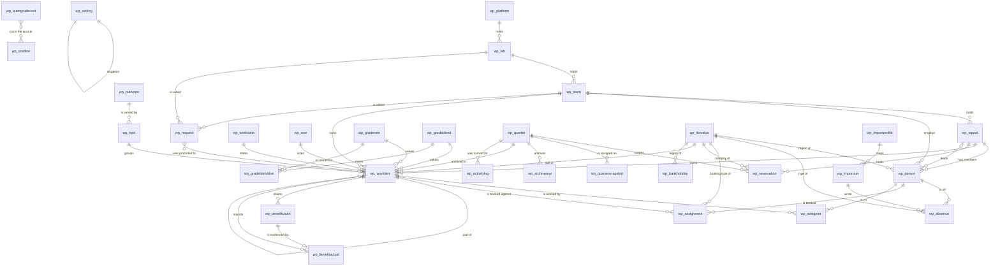

# Waypoint on Dataverse: the data model

This explains `waypoint.model.yaml`, which is the authority. Read this first, build from that.

Waypoint plans a quarter of engineering capacity. People belong to squads, work items charge member
weeks against the quarter, absences and reservations take capacity away, and benefit claims turn
delivered work into money. A platform holds labs, a lab holds teams, and a team is what the planner
plans. The model is 31 tables and 297 columns.

Two environment variables sit beside the tables in the Waypoint solution and carry no data of their
own: `wp_SourceOfTruth` (text, default `Manual`) and `wp_UseGridControl` (two options, default
`false`). They decide which fields the app writes and which surfaces it shows, not what is stored;
the model is the same in either state. See `decisions.md`, "Source of truth flag".

## Naming conventions

| Thing | Convention | Example |
| --- | --- | --- |
| Publisher prefix | `wp` | |
| Table logical name | prefix, then the singular noun, lower case, no separators | `wp_workitem` |
| Column schema name | prefix, then the field name, lower case | `wp_claimedfte` |
| Lookup column | the field name with `id` on the end | `wp_squadid` |
| Choice set | prefix, then what it is a set of | `wp_capacityimpact` |
| Alternate key | table name, then what makes the row unique | `wp_workitem_title` |
| Choice labels | the exact strings the engine compares against | `In development` |

Choice labels are not free text. `src/engine/work.ts` compares state names literally, and
`src/store/validate.ts` compares kinds, employments and benefit types literally. Rename a label and
the rules stop matching.

## Entity diagram



The last two edges are notation only: Setting is a one-row table, and the two cost tables are not
related to each other, they simply both feed the Money page.

## The hierarchy, and the front door

Four tables were added at model version 2.0, from `design-front-door.md`.

`wp_platform`, `wp_lab` and `wp_team` are the hierarchy: a platform holds labs, a lab holds teams, a
team holds squads. Twenty-one tables gained a `wp_teamid` lookup so the app can narrow every
collection it loads to the team, the lab or the platform in scope. The lookup is required on the
nine tables whose rows belong to exactly one team (`wp_person`, `wp_squad`, `wp_workitem`,
`wp_epic`, `wp_outcome`, `wp_assignment`, `wp_absence`, `wp_benefitclaim`, `wp_benefitactual`) and
optional on the other twelve, where blank means shared across the platform. Five tables carry no
team at all, because what they hold is a platform decision: `wp_bankholiday`, `wp_size`,
`wp_setting`, `wp_importprofile` and `wp_gradeblendline`.

`wp_request` is the front door: a request arrives, a product owner screens it, and it is promoted to
a work item or declined with a reason. Thirty-five columns, one of them the title; the other
thirty-four are the question bank. Four new choice sets carry the answers that are not free text
(`wp_productline`, `wp_frequency`, `wp_datasensitivity`, `wp_urgency`) and a fifth,
`wp_requeststatus`, is the lifecycle: New, Screened, Promoted, Declined. The requester is held as a
name and an email, with an optional `systemuser` lookup beside them, so a request still reads when
the user row has gone. `wp_promotedtoid` points at the work item the request became, and the link is
read from the request side, so the register gains no column. Decline categories are text, not a
choice, until the queue has run long enough to say what the categories are.

## The four self-lookups on a work item

`wp_parentid` is the feature a component is part of, one level only. `wp_dependsonid` is another item
this one waits on. `wp_convertedtoid` is the feature a feasible spike became; `wp_convertedfromid` is
the spike a feature came out of. The mock stores both directions of the conversion, so the model does
too. Parent is `Restrict` on delete; the other three are `RemoveLink`.

## Choice sets

Seventeen sets, all in the YAML with their values. The ones the engine compares against by name:
`wp_workkind` (Feature, Spike, Component), `wp_capacityimpact` (None, Reserved, Allocated, Consumed,
Historical, Hold, Removed), `wp_commitment`, `wp_spikeoutcome`, `wp_employment`, `wp_teamgrade`,
`wp_benefittype` and `wp_claimcolumn`. Two are numbered deliberately: `wp_month` is the month number
plus 100000000, and `wp_deliverystatus` ends in its `STATUS_RANK`, so the parent roll-up is a `Max`.

Three things are deliberately not choice sets. The **state** is a table, because Settings lets the
team edit the state model and the impact each state carries, and the engine reads the impact rather
than the name. **Size** is a table, because calibration suggests new member weeks for a band. The
four **Settings lists** are one table, because the app adds, renames and removes values at run time
and refuses a removal that something still uses. A fifth list, **Role**, sits in the same table: the
job titles the roster writes, each carrying in `wp_grade` the team grade that role maps to (C, D, E
or F).

## Keys

Every table that the mock addresses by name gets a name alternate key: Person, Squad, Work item,
Quarter, Work state, Size, Outcome, Epic, Business grade, Grade blend. Beyond those:

| Table | Key | Why |
| --- | --- | --- |
| `wp_absence` | person, from, to | Exactly the key `readWorkday()` dedupes on, which makes the import idempotent. |
| `wp_assignee` | work item, person | One person cannot hold two slots on one item. |
| `wp_benefitclaim` | work item, benefit type | One claim of a type per item. |
| `wp_benefitactual` | work item, benefit type | `validateBenefitActual` refuses a second actual for a claim. |
| `wp_reservation` | squad, quarter, category | `validateReservation` refuses a duplicate triple. |
| `wp_listvalue` | list, value | The same word can be a skill and a region. |
| `wp_importprofile` | source | One profile per source, as `loadProfiles()` keys them. |
| `wp_setting` | name | What keeps the singleton single. |

The Jira key on a work item is a candidate key with a caveat: a Dataverse alternate key treats two
blanks as equal, so make it a key only if every item carries a Jira key. Otherwise let the import
flow check.

## Where the model differs from the mock

- **Benefit claims** become rows, not a JSON record. The reason is in the YAML.
- **Assignees** become rows, not an array of three.
- **The Quarter** becomes a table. Settings keeps the dials that hold across quarters; label, epoch,
  sprint length, benefit year, timeline year, weeks and the two targets move onto the quarter row.
- **Grade and blend** become two lookups. The mock keeps one text field for both, which is why
  `validateGrade` and `validateBlend` have to police name collisions between the two lists.
- **The Role list** is new. The mock keeps a person's role as free text; here every distinct role is
  a `wp_listvalue` row on the Role list, seeded from the people with the grade its holders are on.
- **`logAbsences`** becomes a Boolean. The mock stores the text Yes or No.
- **A benefit actual's value** becomes a number. The mock's type allows a string and treats one as
  zero; the form already refuses a blank.
- **The activity log** becomes a table of its own. The mock already keeps an audit trail on the
  dataset (`LogEntry` in `src/model/types.ts`: `at`, `label`, `summary`, `user`), capped in memory;
  every commit appends to it, including an undo. `wp_activitylog` is that trail, uncapped, with
  `label` and `summary` as two columns rather than one string: the label is what was done ("Commit
  Statement matching rules v2"), the summary is what changed. **Import run** is new.

## Stage actions: what a work item may do next

`nextActions()` in `src/store/validate.ts` decides which buttons a work item offers, and
`applyAction()` in `src/store/useDataset.ts` applies them. The state model is a table, but the moves
between states are not: they are this list, and nothing else writes `wp_stateid` from a button.

| Action | Precondition | Target state | Also writes | Who |
| --- | --- | --- | --- | --- |
| Conclude | Kind is Spike | unchanged | Spike outcome and findings | Engineering lead, Product Owner, assigned squad member |
| Convert to a feature | Kind is Spike, outcome Feasible, not already converted | the spike goes to Done | A new Feature row, with `wp_convertedtoid` and `wp_convertedfromid` both ways | Product Owner, Engineering lead |
| Send for assessment | Kind is Feature, phase is Shaping | Ready | Nothing. Unsized, it must pass the Engineering form first (`validateEngineering`) | Engineering lead |
| Commit | State is Ready | unchanged | Commitment goes to Committed | Product Owner, Engineering lead |
| Defer | State is Ready | Deferred | | Product Owner, Engineering lead |
| Release | State is In development | Released | | Engineering lead, assigned squad member |
| Validate | State is Released | In validation | | Engineering lead, Product Owner |
| Mark done | State is In validation | Done | | Engineering lead, Product Owner |
| Cancel | Any state whose capacity impact is not Removed | Cancelled | A cancellation reason, which is required | Product Owner, Engineering lead |

Two things to hold on to. Cancel is offered from everywhere except an item already out of the plan,
which is what the Removed impact means, so a Cancelled or Deferred item is not offered it twice.
And "Send for assessment" is one button with two rules behind it: sized, it goes straight to Ready;
unsized, the engineering fields have to validate first.

The "Who" column is the privilege matrix in the model file read back as intent. Dataverse enforces
the write privilege on `wp_workitem`; the button's `Visible` enforces the precondition. Neither
enforces the other, so set both.

## Where each engine rule lives

Three places. In the app as a Power Fx named formula or user-defined function; in Dataverse as a
calculated or rollup column; or on the server as a flow or low-code plugin.

The rule of thumb: anything depending on the sprint grid, the quarter window, absence or another
person's bookings cannot be a Dataverse calculated column, because those see one record and one hop.
That is most of the engine. Dataverse gets the one-hop lookup, the counts and sums over children, and
the writes that must happen once and be recorded.

### In the app (Power Fx)

| File | Functions | Note |
| --- | --- | --- |
| dates.ts | `networkdays`, `overlapWeek`, `quarterRange`, `weekday`, `addDays`, `daysBetween`, `roundHalfEven` | Date helpers. `networkdays` is sketched below. |
| context.ts | `buildContext`, `sprintStart`, `sprintEnd`, `itemSpan`, `bankHolidayCount`, `bookingKey` | `App.OnStart` builds the same thing: collections, plus named formulas for the quarter, the sprint grid and the timeline weeks. |
| capacity.ts | `netMW`, `netFactor`, `daysPerWeek`, `modifier`, `weekDays`, `personWeek`, `bookedDays`, `ownDays`, `itemBookings`, `freeFor`, `timelineWeek`, `absenceMW`, `squadNetMW`, `isSickness` | The person-week arithmetic behind the timeline and the capacity check. It reads a week's bookings, so it runs over collections. `netMW` sketched below; `absenceMW` is an aggregate, so its per-row helper is sketched and its own rules are in prose. |
| work.ts | `sizeMW`, `ownMW`, `totalMW`, `workMW`, `commitment`, `counts`, `inPlan`, `squadCommittedMW` | Sketched below. `ownMW` and `totalMW` are also in Dataverse, for reporting. |
| value.ts | `gradeRate`, `claimMonth`, `claimShare`, `benefitValue`, `benefitCalendar`, `gbpInYear`, `fteClaimed` | `benefitValue` sketched below, `benefitCalendar` in prose. |
| delivery.ts | `deliveryStatus`, `deliveryStatuses`, `deliverySummary` | In prose. |
| capacityCheck.ts | `capacityCheck` | In prose. |
| reservations.ts | `reservationDrawn`, `reservationRows`, `squadReservedMW`, `reservedTotal` | In prose. |
| sprintPlan.ts | `sprintPlan`, `sprintAvailableMW` | The squad-by-sprint matrix behind the Sprint plan. In prose. |
| calibration.ts | `originalOwnMW`, `originalMW`, `actualMW`, `estimates`, `estimateAccuracy`, `liveDeliveredRows`, `calibrationBand` | Arithmetic over the work collection; the band also reads the archive. |
| compute.ts | `compute` | The whole quarter in one record. In the app it is the set of named formulas the screens read. |

Sixty exported rules, all in the app. The count is the functions named above; the parity harness in
`src/engine/parity.ts` is test-only and is not one of them.

### In Dataverse (calculated or rollup)

| Column | Kind | Definition |
| --- | --- | --- |
| `wp_workitem.wp_ownmw` | Calculated | The MW override if set, else the size band's MW, one hop through `wp_sizeid`. |
| `wp_workitem.wp_totalmw` | Rollup | `SUM` of child `wp_ownmw`. Reporting only. |
| `wp_workitem.wp_childcount` | Rollup | `COUNT` of children. Stands in for `ctx.kids`. |
| `wp_squad` counts | Rollup | People and work items per squad, for views and dashboards. |

Four, all conveniences. Rollups refresh hourly at best, so no screen depends on them; the screens
recompute from their collections.

### On the server (flow or low-code plugin)

Six jobs, each because it writes many rows, talks to another system, or must be recorded whether or
not the app did it: the **quarter close** (mark ended items Done, snapshot, archive, advance), the
**Workday import**, the **Jira import and pull** (with Copilot Studio over it), the **activity log**
(a plugin step or a Dataverse trigger flow), the **quarter's start and end dates** from its label,
and **applying a calibration** to the size bands.

**Summary: 60 rules in the app, four columns in Dataverse, six server jobs.**

### The simple ones, in Power Fx

Written as user-defined functions in `App.Formulas`. The date helper is first because everything uses
it.

```powerfx
// dates.ts networkdays(). There is no NETWORKDAYS in Power Fx.
WorkingDays(A:Date, B:Date): Number =
    If(B < A, 0,
       CountIf(
           ForAll(Sequence(DateDiff(A, B, TimeUnit.Days) + 1, 0) As N,
                  { D: DateAdd(A, N.Value, TimeUnit.Days) }) As R,
           Weekday(R.D, StartOfWeek.Monday) <= 5));

// capacity.ts netMW(): working days in the quarter, less bank holidays and absence,
// times (1 - modifier), over five. Part time scales all three alike.
NetMW(P:Record): Number =
    With({ dpw: Coalesce(P.'Days per week', MWDays),
           mod: Coalesce(P.'Modifier override', If(P.Lead, LeadModifier, DefaultModifier)) },
      If(P.Employment = 'Employment'.'Open vacancy', 0,
        With({ work: WorkingDays(QuarterStart, QuarterEnd) * dpw / MWDays,
               bh:   If(LogAbsences, BankHolidayDays(P.Region, QuarterStart, QuarterEnd) * dpw / MWDays, 0),
               abs:  If(LogAbsences, AbsenceDays(P) * dpw / MWDays, 0) },
          Max(0, work - bh - abs) * (1 - mod) / MWDays)));

// work.ts workMW(): the total spread over the item's sprints, times the share of
// their working days inside the quarter. A feature with components charges nothing.
WorkMW(W:Record): Number =
    With({ ks: W.'Absolute start sprint', ke: W.'Absolute end sprint' },
      If(W.'Component count' > 0
         || Max(ks, FirstSprint) > Min(ke, LastSprint), 0,
         (OwnMW(W) / Max(1, ke - ks + 1))
         * Sum(Filter(colSprintDays, Num >= ks && Num <= ke), WorkDays)
         / (SprintDays / 7 * 5)));

// work.ts commitment(): the state overrules the flag.
CommitmentOf(W:Record): Text =
    If(W.State.Name in ["Identified", "In discovery"]
       || W.Commitment = 'Commitment'.Proposed, "Proposed", "Committed");

// work.ts counts().
Counts(W:Record): Boolean =
    W.State.Impact in ['Capacity impact'.Allocated, 'Capacity impact'.Consumed]
    || (W.State.Impact = 'Capacity impact'.Reserved && CommitmentOf(W) = "Committed");

// value.ts benefitValue(), in-year half: FTE at its grade rate plus cost avoidance,
// both pro-rated by the landing month. Month 13 is a share of zero.
ClaimMonth(W:Record): Number =
    With({ y: Coalesce(W.'Landing year', BenefitYear) },
      If(y < BenefitYear, 1,
         y > BenefitYear, 13,
         Coalesce(Value(W.'Landing month'), 100000001) - 100000000));

BenefitInYear(W:Record): Number =
    With({ share: (13 - ClaimMonth(W)) / 12 },
      Coalesce(W.'FTE released', 0) * share * GradeRateOf(W)
      + CostAvoidanceOf(W) * 1000000 * share);

// The per-row helper behind capacity.ts absenceMW(): the productive MW one absence row
// loses inside the quarter, scaled exactly as NetMW deducts it. The engine's absenceMW()
// is the aggregate over these; its rules are in prose below.
AbsenceMW(A:Record): Number =
    With({ lo: If(A.From > QuarterStart, A.From, QuarterStart),
           hi: If(A.To < QuarterEnd, A.To, QuarterEnd), P: A.Person },
      Max(0, WorkingDays(lo, hi) - BankHolidayDays(P.Region, lo, hi))
      * (Coalesce(P.'Days per week', MWDays) / MWDays)
      * (1 - ModifierOf(P)) / MWDays);
```

Two cautions. `Max(date1, date2)` is not Power Fx; the clipping above uses `If`. And the
`Sequence`-based `WorkingDays` is slow if called per person per week, so the app computes the
quarter's working days once into a named formula and the week grid once into a collection.

### The hard ones, in prose

**`capacityCheck`, and the finish walk.** Take the item's distinct assignees, up to three, and divide
its MW this quarter between them: that is each person's required share. Clip the item's sprint span to
the quarter and turn it into a first and last timeline week; a span outside the timeline returns the
item marked "outside" and nothing else. For each assignee, sum `freeFor` across the item's weeks; the
shortfall is the required share less that, floored at zero. Then walk forward from the item's first
week to the end of the timeline year, adding `freeFor` week by week, and the first week the running
total reaches the required share is that person's finish week. Never reaching it means no finish week.
The item finishes on the latest of its assignees', and if one never finishes, neither does the item.
Turn the finish week's Friday into a sprint number by counting sprint lengths from the epoch; the slip
is that sprint less the item's own end sprint. `freeFor` is the week's capacity after the modifier,
capped at what is free once the person's other bookings are taken off.

In Power Apps this is a `ForAll` over the assignees, with the walk a `ForAll(Sequence(...))` over the
weeks. It is the most expensive thing in the app, so it runs for one item at a time on the work item
screen, and Command caches its "at risk (capacity)" pass in a collection for the session.

**`benefitCalendar`.** One row per work item, in work order, across twelve months of the benefit year.
A row carries its claimed FTE from the month it lands in through to December: a claim that landed
before the benefit year starts at month 1, and one landing after it, or with no landing month, is
empty. FTE in-year is that walk over twelve. Pounds in-year are the FTE in-year at the grade rate plus
a twelfth of the cost avoidance from the same month. The totals count the plan only, except two
hypothesis lines that count every listed item: December's FTE if everything lands, and the cumulative
pounds the same way. The target line spreads the pound target evenly over the year. The gap is
December's live FTE less the FTE target. In the app it is one `ForAll` producing twelve columns, with
`Sum` over it for the totals.

**The delivery status ladder.** For one item, in order: a feature with components has no status of its
own, and neither has an item that is Identified, Deferred or Cancelled. With a done sprint it is Done
on time when that sprint is at or before its end sprint, Done late otherwise. A Historical impact is
Done, sprint unknown. Past its end sprint it is Late. In development in its last sprint, or In
discovery or Ready in its last or second-last sprint, it is At risk. Otherwise On track. Then two
passes. The **capacity overlay**: a counted item with a capacity check, not outside, with no done
sprint and no components, whose assignees show a shortfall, moves from On track or At risk to At risk
(capacity). The **roll-up**: a feature takes the worst status among its children by rank, On track 1
through Late 7. The delivered, on-time, cycle time and carry-over figures all read the ladder *before*
the overlay and the roll-up, so a feature is never counted twice with its components.

**`absenceMW`, the absence report.** The Power Fx `AbsenceMW` above is one row. The engine's
`absenceMW(ctx, opts)` is the whole report behind the Team page's absence block, and it returns five
things at once: total working days lost, total MW lost, the same two broken down by person, the same
two broken down by type, and whether Settings has absence coming off capacity at all. Four rules go
with it. It **filters by squad** when asked. It **skips any absence whose person is not on the
roster**, so a leaver's history does not count against the quarter. It **clips every span** to the
quarter and takes the person's own region's bank holidays off, as the per-row helper does. And it
**treats every type whose name starts "sick" as one type**, which is `isSickness()`: "Sick", "Sick
leave" and "Sickness" all land on the same line of `byType`, and every other type matches on its
exact name, ignoring case. The MW is reported whether or not Settings deducts it; only `netMW` reads
the deduct flag. In the app this is one `ForAll` over `colAbsences` with the same three filters, and
the sickness test is the `IsSickness` user-defined function, never a literal comparison to "Sick".

**The sprint plan.** A row per squad, a column per sprint of the quarter, and the quarter itself as a
last column. Each cell carries available, committed, proposed, reserved, remaining and utilisation.
The point of it is that the three quantities spread across the sprints three different ways, and the
workbook's Sprint plan sheet is only reproduced if all three are kept apart.

1. **Capacity spreads by working-day share.** A person's availability in a sprint is the engine's own
   week rule, pro-rated: for every week the sprint touches, take the week's capacity after the
   modifier and multiply it by the share of that week's working days falling inside both the sprint
   and the quarter. A short first or last sprint therefore brings less. An open vacancy brings
   nothing.
2. **Demand spreads evenly per sprint.** An item's own MW is divided by the number of sprints it
   spans, and every sprint of that span inside the quarter takes one whole share, whether the sprint
   is short or not. This is deliberately not the working-day share: the workbook plans work by
   sprint, not by day. Counted work goes to committed; work that is Reserved and still Proposed goes
   to proposed and is reported beside it, never taken off. A feature with components charges nothing,
   as everywhere else.
3. **Reservations spread by the working-day share**, the same share as capacity, so a short sprint
   holds less of them. The squad's held MW is `squadReservedMW`, which already includes its share of
   the Team reservations.

Remaining is available less committed less reserved; proposed is not deducted. Utilisation is
committed over available, except that where there is demand and no capacity at all the cell reads
**9.99**. That is the workbook's own marker for "infinitely over-committed", not a percentage, and
the app shows it as a flag with words beside it rather than a number to two decimal places.

**The reservation drawdown.** What draws a reservation down depends on its category. Discovery and
Spikes are drawn down by counted spike work in that squad. Shaping and refinement is drawn down by
counted component work in the Shaping or Assessment phase. Every other category is drawn down by typed
assignments whose booking type matches the category name (model version 1.1: `wp_assignment.wp_typeid`
is optional, blank for a work booking, which carries a work item instead, and set for a non-work one):
the working days inside both the booking and
the quarter, over five, times that person's net factor, so a booking draws the net member weeks the
person really has, not the gross span. An assignment naming a person who has left draws nothing, and a
reservation only draws down in the quarter it names. Remaining is held less drawn, floored at zero,
except that a squad row is worth nothing when a Team row already holds the same category and quarter.
A squad's reserved MW is its own remaining plus its net-capacity share of the Team reservations still
standing.
